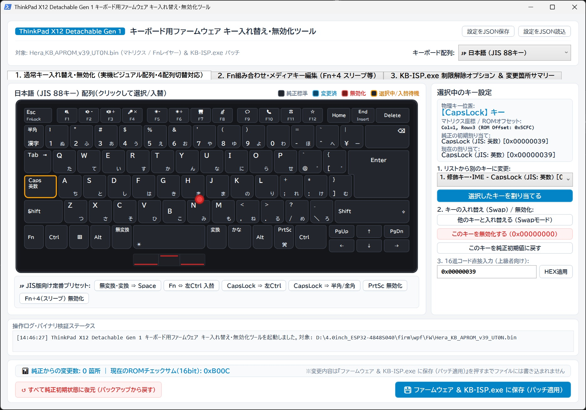
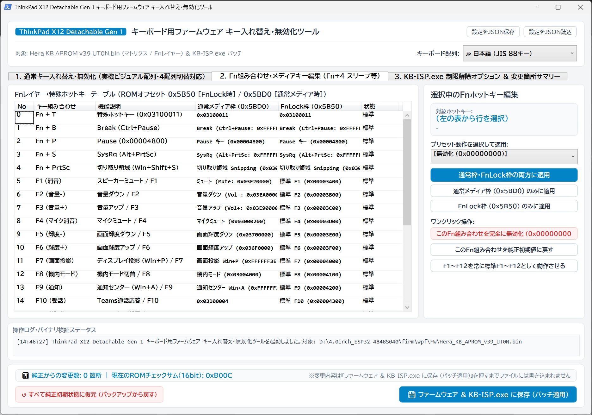
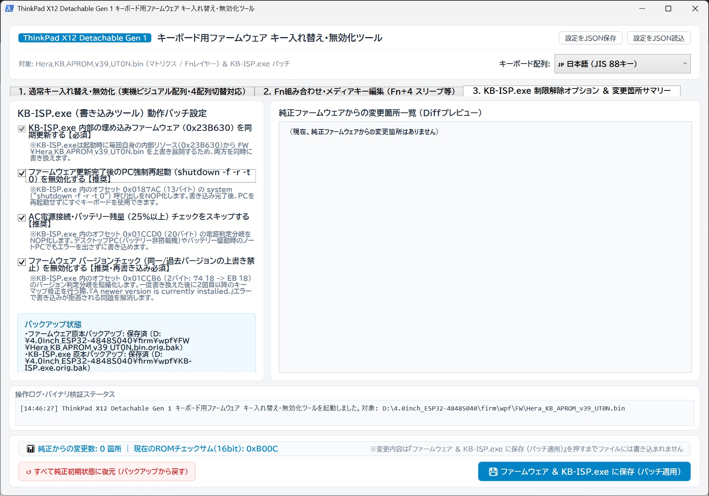

## ThinkPad X12 Detachable Gen 1 キーボード用ファームウェア キー入れ替え・無効化ツール

[](https://microsoft.com)
[](https://microsoft.com)
[](#-対応キーボード配列)
[](#-安全設計著作権ポリシー)

Lenovo ThinkPad X12 Detachable Gen 1 の外付けフォリオキーボードのキー配置や機能を  
視覚的にカスタマイズできる、WindowsネイティブのWPF GUIツールです。  
直感的な操作画面で、キーの入れ替え（Fn⇔Ctrl等）や無効化、定番プリセット適用、  
再起動抑止やバージョンチェック無効化パッチをワンクリックで実行できます。

Windows 11と、UK版キーボード(FRU:5M11A37017)にて動作確認を行なっています。  
本キーボードはファームウェアファイルが言語間で共通のため、  
他多国語版でも動くと思います。……たぶん。

> ⚠️ **ご注意**
>
> 本リポジトリには、キーボードのファームウェアや書換ツールは含まれていません。


---

## 🏢 公式ファームウェア・書き込みツールの入手手順

キーボードのファームウェアとその書換ツールは、以下のリンク（レノボのサポートページ）から入手してください。

| 項目                       | 内容                                                                                                                                                                                                                                                                                                  |
|:-------------------------- |:----------------------------------------------------------------------------------------------------------------------------------------------------------------------------------------------------------------------------------------------------------------------------------------------------- |
| **更新ツールの名称**       | **フォリオ ケース キーボード ファームウェア** (Folio case Keyboard FW)                                                                                                                                                                                                                                |
| **ダウンロードファイル名** | `r1gkb08w_v2.exe` (約 4.0 MB)                                                                                                                                                                                                                                                                         |
| **バージョン**             | **3339** (リリース日: **2024年8月8日**)                                                                                                                                                                                                                                                               |
| **公式配布ページURL**      | [Lenovo サポート　ダウンロードページ](https://pcsupport.lenovo.com/jp/ja/products/laptops-and-netbooks/thinkpad-x-series-laptops/thinkpad-x12-detachable-gen-1-type-20uw-20uv/downloads/ds549257-folio-case-keyboard-firmware-for-windows-10-version-1903-or-later-thinkpad-l13-gen-2-l13-yoga-gen-2) |

### 📂 ファイルの展開・配置ステップ
1. Release からZipファイルをダウンロードして展開します。
3. 上記のレノボ公式サイトからダウンロードした `r1gkb08w_v2.exe` を起動します。
4. 使用許諾に同意後、**必ず「展開のみ」を選択** して「次へ」をクリックします。
5. 指定した宛先フォルダーに自己展開ローダーである **`KB-ISP.exe`** が展開されます。
6. 一度**`KB-ISP.exe` をダブルクリックして起動** します（起動すると内部リソースから同フォルダー内に **`FW` フォルダ** および　　
   `UpdateKeyboard.exe` が自動展開されます。起動確認後、すぐにウィンドウを閉じて終了してください）。
7. 展開された以下のファイル・フォルダーを、本ツールのフォルダー直下に配置します：
   - **`KB-ISP.exe`**（ツール直下へ）
   - **`UpdateKeyboard.exe`**（ツール直下へ）
   - **`FW/` フォルダ**（`Hera_KB_APROM_v39_UT0N.bin` および `command.exe` を含むフォルダーごとツール直下へ）

---

## 🌟 主な特長








1. **直感的な編集**
   - 変更したいキーをクリックして、別のキーを割り当てたり、他のキーとスワップ（入れ替え）したり、ワンクリックで無効化可能。
2. **4言語配列（JIS / UK / US / FR）完全対応**
   - 右上のプルダウンから言語配列を切り替え可能。
   - 各言語向けに最適化された定番プリセットボタンを搭載。
3. **Fnレイヤー・特殊ホットキー編集（タブ2）**
   - Fn+4（スリープ）や各種Fnキー組み合わせの動作を個別に編集・無効化可能。
4. **KB-ISP.exe 制限解除パッチ機能（タブ3）**
   - **強制再起動抑止**: 書き込み完了後のPC強制再起動を無効化。
   - **電源チェック解除**: AC電源未接続やバッテリー25%未満時の書き込みブロックをスキップ。
   - **バージョンチェック解除**: 一度書き換えた後、2回目以降の書き込み時に発生する「*A newer version is currently installed.*」エラーを解消し、何度でも自由に再書き込み可能。
5. **自動バックアップ＆復元機能**
   - 初回起動時に、純正ファームウェアおよび `KB-ISP.exe` の原本バックアップ（`.orig.bak`）を自動作成。
   - 「↺ すべて純正初期状態に復元」ボタンから、いつでもワンクリックで工場出荷時の純正状態へ戻せます。

---

## ⌨️ 対応キーボード配列

| 言語 / 配列                     | FRU        | 主な刻印・特徴                                                        |
|:------------------------------- |:----------:|:--------------------------------------------------------------------- |
| **🇯🇵 日本語 (JIS)**             | 5M11A37002 | 半角/全角、無変換、変換、かな、逆L字Enter                             |
| **🇬🇧 英語 (UK / ISO)**          | 5M11A37017 | ISO逆L字Enter、左Shift横のISOキー（`\ \|`）                           |
| **🇺🇸 英語 (US / ANSI)**         | 5M11A36992 | 横長Enter、横長左Shift                                                |
| **🇫🇷 フランス語 (FR / AZERTY)** | 5M11A36993 | AZERTY配列、Échap、²、ISOキー（`> <`）、ISO逆L字Enter、AltGr、ImpÉc ✂ |

### ⚡ 定番プリセット（ワンクリック適用）

- **共通**: `Fn ⇔ 左Ctrl 入替`、`CapsLock ⇒ 左Ctrl`、`PrtSc (ImpÉc) 無効化`、`Fn+4 (スリープ) 無効化`
- **JIS配列専用**: `無変換・変換 ⇒ Space (親指スペース拡張)`、`CapsLock ⇒ 半角/全角 (IME切替)`
- **UK / FR配列専用**: `左Shift隣のISOキー ⇒ 左Shift拡張`、`ISOキー ⇒ JIS [ろ (＼ _)]`、`AltGr ⇒ 半角/全角 (IME切替)`

---

## 📂 ファイル構成

```
.
├── KeyRemapTool.bat              # ダブルクリック起動用バッチ
├── KeyRemapTool.ps1              # WPF GUIスクリプト本体
└── README.md                     # 本ドキュメント
```

*(※公式の `KB-ISP.exe`, `UpdateKeyboard.exe`, `FW/` は各自で配置してください)*

---

## 🚀 使い方

### STEP 1: ツールを起動する

フォルダー内の **`KeyRemapTool.bat`** をダブルクリックして起動します。

### STEP 2: キーを入れ替える・無効化する

1. 画面右上の **「キーボード配列」** プルダウンから、お使いのキーボード配列（JIS / UK / US / FR）を選択します。
2. 左側のキーボード図から変更したいキーをクリックし、右側のパネルから割り当てたいキーを選択するか、キーボード下部の **定番プリセットボタン** をクリックします。
3. （任意）Fn組み合わせキーを変更したい場合は **「2. Fn組み合わせ・メディアキー編集」** タブ、書き込みツールの動作オプションを変更したい場合は **「3. KB-ISP.exe 制限解除オプション」** タブで設定します。

### STEP 3: 保存してパッチを適用する

画面右下の **「💾 ファームウェア ＆ KB-ISP.exe に保存 (パッチ適用)」** ボタンをクリックします。

### STEP 4: キーボードに書き込む

同じフォルダー内にある **`KB-ISP.exe`** をダブルクリックして起動し、画面の指示に従ってキーボードへの書き込みを実行します。
（書き込み完了後、PCを再起動せずにそのまま新しいキー設定が反映されます）

---

## ⚠️ 免責事項

- 本ツールは非公式のカスタマイズツールであり、Lenovoとは一切関係ありません。
- ファームウェアの書き換え作業は自己責任において実施してください。

  
